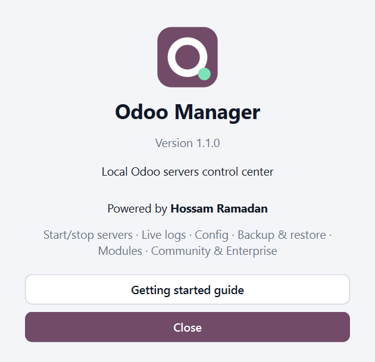
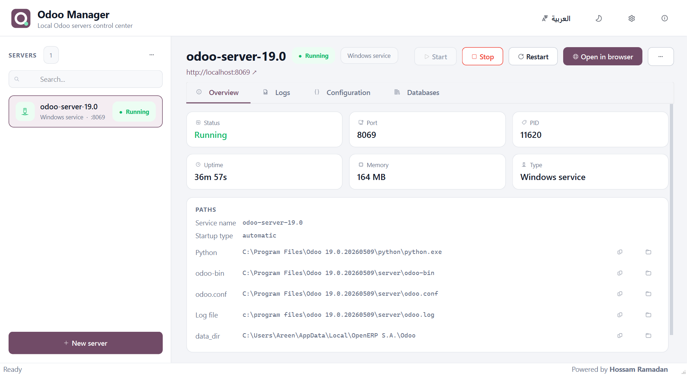
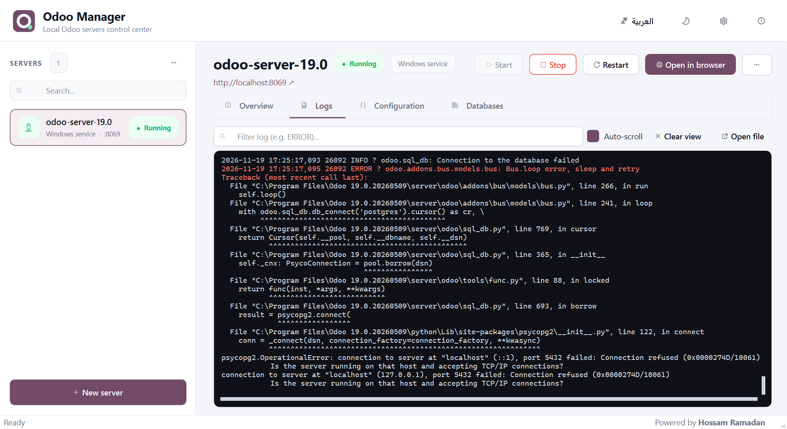
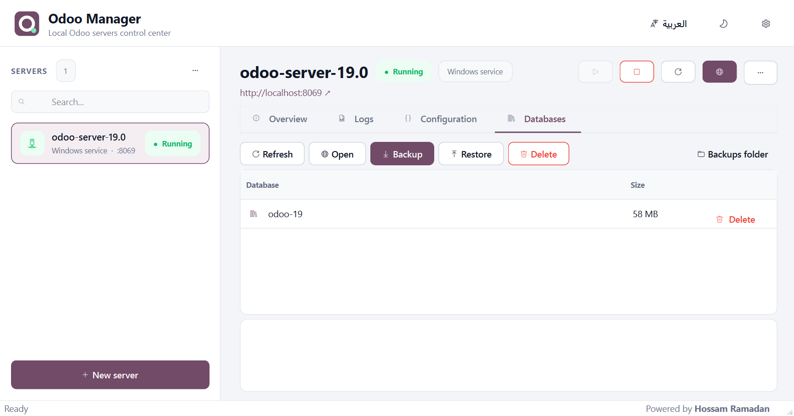
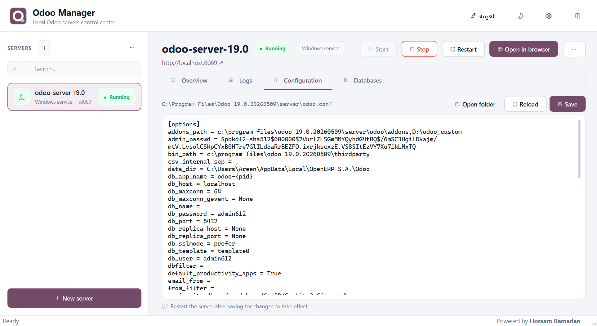
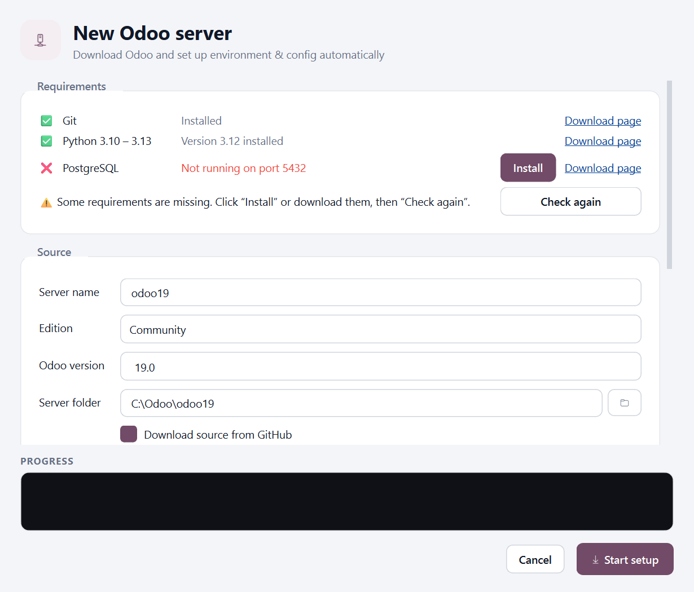
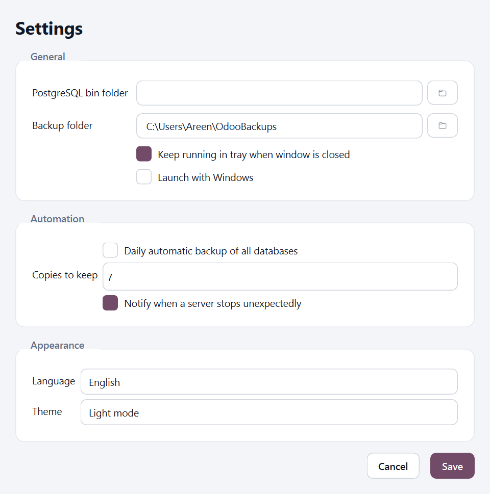
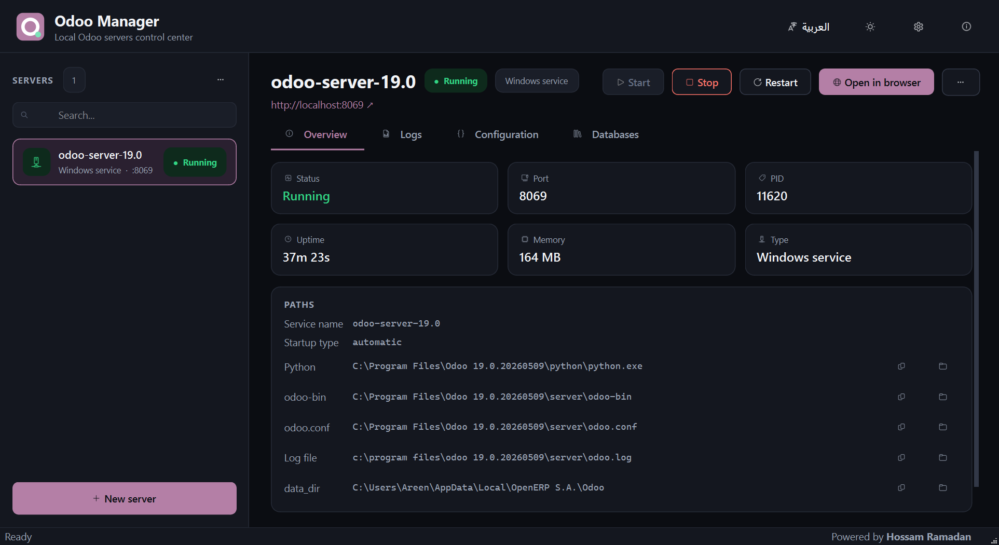

<div align="center">



# Odoo Manager

**One desktop app to run, monitor, back up and extend every Odoo server on your Windows PC.**

[](https://github.com/hossam4533/odoo_manager/releases/latest)
[](https://github.com/hossam4533/odoo_manager/releases)


-41CD52)


[**Download**](https://github.com/hossam4533/odoo_manager/releases/latest) ·
[User guide (PDF)](docs/Odoo-Manager-User-Guide.pdf) ·
[Features](#features) ·
[Quick start](#quick-start) ·
[FAQ](#troubleshooting--faq)



</div>

---

## Table of contents

- [Why Odoo Manager](#why-odoo-manager)
- [Features](#features)
- [Screenshots](#screenshots)
- [System requirements](#system-requirements)
- [Quick start](#quick-start)
- [Using the app](#using-the-app)
  - [Servers](#servers)
  - [Logs and configuration](#logs-and-configuration)
  - [Databases](#databases)
  - [Custom modules](#custom-modules)
  - [New-server wizard](#new-server-wizard)
  - [Settings and automation](#settings-and-automation)
- [Updates](#updates)
- [Security and privacy](#security-and-privacy)
- [Where things are stored](#where-things-are-stored)
- [Troubleshooting / FAQ](#troubleshooting--faq)
- [Build from source](#build-from-source)
- [Releasing a new version](#releasing-a-new-version)
- [Project layout](#project-layout)
- [Roadmap](#roadmap)
- [Disclaimer](#disclaimer)

---

## Why Odoo Manager

Odoo developers and implementers on Windows spend a surprising amount of time on chores that have nothing to do with Odoo itself:

- a terminal window per server, and remembering which one runs on which port;
- editing `odoo.conf` by hand — often inside *Program Files*, where Windows blocks saving;
- digging for log files when something breaks;
- taking backups through the database manager page, one database at a time;
- port clashes and database cross-talk when two Odoo versions run side by side;
- setting up Python, PostgreSQL, Git and a virtualenv every time a new version comes out.

**Odoo Manager puts all of that in one window.** It works with Odoo installed by the official Windows installer
(as a Windows service) and with source installs started through `odoo-bin` — side by side.

## Features

### Server control
- Start, stop, restart and open any server in the browser.
- Windows services (official installer) and `odoo-bin` instances in one list, with live status, port, PID, memory and uptime.
- Odoo services are **detected automatically** at every launch.
- **Port-conflict detection** before a server starts, naming the program that holds the port.
- Per-server autostart when the app opens; optional start with Windows.
- **Stop alerts**: a notification when a server stops without you stopping it.

### Logs and configuration
- **Live log viewer**, colour-coded by level (`INFO`, `WARNING`, `ERROR`, `CRITICAL`), auto-scroll and instant filtering.
- **`odoo.conf` editor** with save-and-restart. Files under *Program Files* are saved through a UAC prompt — no need to run the app as administrator.
- **Copy master password** (`admin_passwd`) in one click, with a clear message when Odoo has already hashed it.

### Databases
- Lists the databases that belong to each server (owned by its `db_user`).
- **Backup** to Odoo's own zip format (`dump.sql` + filestore) — fully compatible with Odoo's database manager.
- **Restore** from `.zip`, `.dump`, `.backup` or `.sql`; refuses names that already exist.
- **Delete** with typed-name confirmation; works even while the server is running.
- **Daily automatic backup** of every database on running servers, keeping the last *N* copies.

### Custom modules
- **Add a module** from a folder or a `.zip` (single module or a folder of modules); the server restarts automatically.
- **Upgrade a module** (`-u`) on a chosen database in the background, surfacing errors from the log.
- If a server has no custom addons folder (typical for the official installer), the app **creates one and registers it in `addons_path`**.

### New-server wizard
- **Requirements check** for Git, Python (version range matched to the Odoo branch) and PostgreSQL — runs in the background so the wizard opens instantly.
- **One-click install** of anything missing via Microsoft *winget*, with a live percentage, elapsed time and a result message. PostgreSQL falls back to a GitHub-hosted build when EnterpriseDB's servers are unreachable.
- **Database user setup**: creates the PostgreSQL role for Odoo and writes `db_user` / `db_password` into every existing server's config.
- Clones Odoo **Community or Enterprise** (`--depth 1`), creates a virtualenv, installs `requirements.txt` and writes a ready-to-run `odoo.conf` with a free port, a random master password and a custom addons folder.

### Everyday comfort
- **Arabic and English** with full right-to-left layout; **light and dark** themes.
- System-tray icon with per-server start / stop / open; closing the window keeps the app running.
- Three-page **welcome tour** on first launch.
- Responsive layout that works on small laptop screens.
- **Signed auto-update** (see [Updates](#updates)).

## Screenshots

<table>
<tr>
<td width="50%"></td>
<td width="50%"></td>
</tr>
<tr>
<td align="center"><sub><b>Live logs</b> — colour-coded, filterable</sub></td>
<td align="center"><sub><b>Databases</b> — backup, restore, delete</sub></td>
</tr>
<tr>
<td></td>
<td></td>
</tr>
<tr>
<td align="center"><sub><b>Configuration</b> — edit odoo.conf in place</sub></td>
<td align="center"><sub><b>New-server wizard</b> — requirement checks and one-click installs</sub></td>
</tr>
<tr>
<td></td>
<td></td>
</tr>
<tr>
<td align="center"><sub><b>Settings</b> — backups, alerts, language, theme</sub></td>
<td align="center"><sub><b>Dark theme</b></sub></td>
</tr>
</table>

## System requirements

| | Minimum |
|---|---|
| Operating system | Windows 10 or Windows 11, 64-bit |
| Disk space | ≈ 60 MB for the app; ≈ 2 GB per Odoo server created by the wizard |
| Internet | Only for the wizard (downloads) and update checks |
| Supported Odoo | 16.0, 17.0, 18.0, 19.0 (Community and Enterprise) |
| To create new servers | Git, Python 3.10 – 3.13 (3.12 recommended for Odoo 19), PostgreSQL 12+ — the wizard installs them |

The app itself is a single self-contained executable; it does not need Python or any runtime installed.

## Quick start

1. Download **`OdooManager-Setup-<version>.exe`** from the [latest release](https://github.com/hossam4533/odoo_manager/releases/latest).
2. Run it. If Windows SmartScreen shows *"Windows protected your PC"*, choose **More info → Run anyway** — the installer is not code-signed yet.
3. Pick the setup language, optionally a desktop shortcut, and finish.
4. On first launch a short tour explains the app. Then:

| You have… | Do this |
|---|---|
| Odoo installed with the official `.exe` | Nothing — it is already in the list. |
| Nothing yet | Click **New server** and follow the wizard. |
| An `odoo-bin` server already set up | **⋯ → Add existing server**, then point to Python, `odoo-bin` and `odoo.conf`. |

## Using the app

### Servers
The left panel lists every server with its status and port. Select one to see its details in four tabs:
**Overview**, **Logs**, **Configuration** and **Databases**. The buttons above the tabs start, stop, restart and open the
server; the **⋯** menu holds edit, open folder, add / upgrade module, open custom addons folder, copy master password
and remove. **Check ports** on the Overview tab lists every server's port and flags conflicts.

Removing a server only removes it from the list by default; you can optionally delete its databases and, for
`odoo-bin` servers, its folder. Nothing is deleted without an explicit confirmation.

### Logs and configuration
The Logs tab follows Odoo's log file live. Type in the filter box (for example `ERROR` or a module name) to narrow it down.
The Configuration tab edits `odoo.conf`; saving offers to restart the server so changes take effect.

### Databases
Backups are written to the backup folder chosen in Settings (default `%USERPROFILE%\OdooBackups`) as
`<database>_<date>_<time>.zip`. Restore always creates a new database, so an existing one is never overwritten.
Backups from an older Odoo version restore fine, but a newer server will not open them until they are upgraded through
Odoo's official upgrade service.

### Custom modules
**⋯ → Add module** copies the module into the server's custom addons folder and restarts the server. Then, in Odoo,
enable developer mode and use **Apps → Update Apps List → Install**. **⋯ → Upgrade module** runs Odoo's upgrade for the
modules you name on the database you choose. Modules must target the same Odoo version as the server.

### New-server wizard
1. The **Requirements** panel shows Git, Python and PostgreSQL with ✅ / ❌. Missing items have an **Install** button;
   every row also links to the official download page.
2. When PostgreSQL is installed, choose the **database user** Odoo will use (default `odoo`) and its password.
   Odoo refuses the `postgres` superuser, so the app never uses it for Odoo.
3. Name the server, choose the Odoo version, the edition and a folder; confirm Python and the HTTP port.
4. Click **Start setup** and follow the progress log. The new server appears in the list when done.

For **Enterprise**, provide the repository URL (requires a subscription or partner access to
`github.com/odoo/enterprise`) or an existing folder; it is placed first in `addons_path`.

### Settings and automation
PostgreSQL tools folder (auto-detected), backup folder, keep running in the tray, launch with Windows,
**daily automatic backup** and the number of copies to keep, **stop alerts**, language and theme.

## Updates

The app checks this repository's latest release 20 seconds after it starts and every 12 hours, and from
**About → Check for updates**. When a newer version exists it offers **Update now**, **Later** or **Skip this version**;
updating downloads the installer, verifies it, installs it silently and reopens the app.

A release can set a **minimum supported version**: older copies must update before they can be used.

## Security and privacy

- **Signed updates** — `latest.json` is signed with an Ed25519 key that never leaves the publisher's machine; the app
  rejects any manifest whose signature does not match, and any installer whose SHA-256 does not match the manifest.
- **No telemetry** — the app sends nothing anywhere. The only network requests are update checks to GitHub and the
  downloads you start in the wizard.
- **Passwords stay local** — they are written only to the `odoo.conf` files they belong to. The PostgreSQL superuser
  password is passed to its installer through a temporary option file, not on the command line.
- **Least privilege** — the app runs as a normal user and asks for administrator rights (UAC) only for actions that
  need them: controlling Windows services and writing files under *Program Files*.

## Where things are stored

| What | Location |
|---|---|
| Server list | `%APPDATA%\OdooManager\instances.json` |
| App settings | `%APPDATA%\OdooManager\settings.json` |
| Logs of `odoo-bin` servers started by the app | `%APPDATA%\OdooManager\logs\` |
| Backups | `%USERPROFILE%\OdooBackups` (configurable) — automatic backups in `auto\<database>\` |

Uninstalling the app (Windows Settings → Apps) never touches your Odoo servers or databases.

## Troubleshooting / FAQ

| Symptom | Cause and fix |
|---|---|
| *Database creation error: Access Denied* | Wrong master password. Use **⋯ → Copy master password**, or set a new `admin_passwd` in the Configuration tab and restart. |
| Master password looks like `$pbkdf2-sha512$…` | Odoo hashed it and it cannot be recovered. Set a new one in the Configuration tab. |
| *password authentication failed for user "…"* | `db_user` / `db_password` in `odoo.conf` do not match a PostgreSQL user. In the wizard, use **Database user** next to PostgreSQL to create the user and update every server. |
| *no password supplied* | `db_password` is empty in `odoo.conf`. Same fix as above. |
| Server starts then stops immediately | Open the Logs tab. A common cause is a Python that was removed together with an older Odoo install — recreate the server with the wizard. |
| *Port … is already in use* | Another server or program holds the port. Use **Check ports**, then change `http_port`. |
| *Internal Server Error* with several Odoo versions | Each version sees the others' databases. Add a `dbfilter` to each server's config. |
| A restored database does not open | It comes from an older Odoo version, or its custom modules are missing — add them with **Add module**. |
| Cannot log in to a restored Odoo Online / Odoo.sh backup | Such backups often have no local password. Reset the user's password in the database. |
| PostgreSQL install is slow or fails | The official installer can take 10+ minutes. If EnterpriseDB is blocked on your network the app downloads PostgreSQL from GitHub instead. |
| Windows SmartScreen warning | The installer is not code-signed yet: **More info → Run anyway**. |

## Build from source

Requirements: Windows, Python 3.12, and [Inno Setup 6](https://jrsoftware.org/isinfo.php) for the installer.

```powershell
git clone https://github.com/hossam4533/odoo_manager.git
cd odoo_manager
py -3.12 -m venv .venv
.\.venv\Scripts\pip install PySide6 psutil psycopg2-binary pyinstaller cryptography
.\.venv\Scripts\python app.py          # run from source
.\build.ps1                            # one-file executable -> dist\OdooManager.exe
& "$env:LOCALAPPDATA\Programs\Inno Setup 6\ISCC.exe" installer.iss   # installer -> dist\
```

| Component | Technology |
|---|---|
| UI | Qt 6 via PySide6 |
| Processes and services | psutil, `sc.exe`, UAC elevation through PowerShell |
| PostgreSQL | psycopg2, `pg_dump`, `pg_restore`, `psql` |
| Packaging | PyInstaller (one-file) + Inno Setup |
| Update signing | Ed25519 (`cryptography`) |

## Releasing a new version

```powershell
# 1. Raise APP_VERSION in odoo_manager/core.py (for example 1.2.0)
# 2. Build, package and sign:
.\.venv\Scripts\python tools\release.py --notes "What changed in this version"
#    optional: --min-version 1.2.0   (force older versions to update)
# 3. On GitHub: Releases → Draft a new release → tag v1.2.0 →
#    upload the three files from dist\release\v1.2.0\ → Publish
```

Installed copies offer the update within 12 hours. The signing key `keys/update_private.pem` is excluded from the
repository — keep a secure backup of it; without it, no further updates can be published to existing installs.

## Project layout

```
app.py                    entry point (single instance, tray start)
odoo_manager/
  core.py                 servers, Windows services, ports, odoo.conf, requirements, installers
  db.py                   PostgreSQL backup / restore / drop
  gui.py                  main window, dialogs, tray, update UI
  wizard.py               new-server wizard, requirement checks, database user setup
  updater.py              signed auto-update
  i18n.py                 English / Arabic strings
  theme.py                light / dark theme, icons
tools/release.py          build, package and sign a release
installer.iss             Inno Setup script
build.ps1                 PyInstaller build
docs/                     user guides (PDF) and screenshots
```

## Roadmap

- Code-signed installer (removes the SmartScreen warning)
- Restore the filestore of existing databases into a new PostgreSQL cluster
- Per-server resource graphs (CPU / memory over time)
- Optional cloud backup destination
- Licensing with a free tier and a Pro plan

## Disclaimer

Odoo is a trademark of Odoo S.A. Odoo Manager is an independent tool and is not affiliated with or endorsed by Odoo S.A.

---

<div align="center">
<sub>Powered by <b>Hossam Ramadan</b></sub>
</div>
